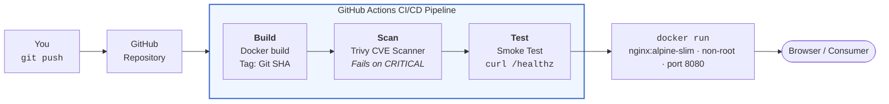

# Project 01: Containerized Static Site Pipeline with Security Gating

[](https://github.com/Samarjeetgit/static-pipeline-cloud-devops/actions/workflows/ci.yml)


A production-grade, end-to-end DevOps pipeline for containerized static web applications. This project enforces immutability, least-privilege security principles, automated vulnerability scanning gates, and container health testing on every push.

---

## Architecture & Flow



---

## 🔒 Production Engineering Practices Implemented

1. **Immutable Artifact Tagging**: The container image is built **once** during the pipeline run and tagged uniquely with the Git commit SHA. What gets tested is exactly what gets deployed.
2. **Security Gate with Teeth**: Uses **Aqua Security Trivy** to inspect the container filesystem. The pipeline is explicitly configured to fail (`exit-code: '1'`) if any `CRITICAL` Common Vulnerabilities and Exposures (CVEs) are detected.
3. **Least-Privilege Execution (Non-Root)**: Standard Nginx images run as `root` by default, posing an unnecessary container breakout risk. This project provisions a dedicated non-privileged user (`appuser` / UID `10001`) and restricts write permissions.
4. **Unprivileged Port Binding**: Because non-root users cannot bind to privileged ports below 1024, Nginx is reconfigured to listen on port `8080`.
5. **Dedicated Health Endpoint**: Includes a lightweight `/healthz` location block that returns an immediate HTTP `200 OK` without triggering disk or database dependencies, ensuring clean orchestration health probes.

---

## 📂 Repository Layout

```text
.
├── .dockerignore                 # Excludes .git, docs, and local configs from build context
├── Dockerfile                    # Pinned alpine-slim base, non-root user setup, healthcheck
├── docker-compose.yml            # Local orchestration with native healthcheck parameters
├── nginx/
│   └── default.conf              # Custom server block (Port 8080 & /healthz endpoint)
├── site/
│   └── index.html                # Responsive landing page
├── .github/
│   └── workflows/
│       └── ci.yml                # 3-stage automated GitHub Actions workflow
└── docs/
    ├── troubleshooting.md        # Documented configuration hurdles and resolutions
    └── failure-notes.md          # Evidence of security gates catching intentional vulnerabilities
```

---

## 🚀 Local Quickstart Guide

Clone the repository and run the application locally using Docker Compose:

```bash
# 1. Clone your repository
git clone https://github.com/Samarjeetgit/static-pipeline-cloud-devops.git
cd static-pipeline-cloud-devops

# 2. Build and start containers in detached mode
docker compose up --build -d

# 3. Verify the dedicated health endpoint
curl -I http://localhost:8080/healthz

# 4. Prove non-root execution security compliance
docker exec -it $(docker ps -q) whoami
# Expected output: appuser (NOT root)

# 5. Teardown and clean up local environment
docker compose down -v
```

---

## 🧪 Failure Testing & Validation

To prove that the security gates function correctly, you can perform these verification steps:
* **Trivy Gate Test**: Temporarily modify `Dockerfile` to use an older, vulnerable base image tag. Observe how the GitHub Actions workflow successfully blocks the build stage upon discovering `CRITICAL` CVEs.
* **Health Check Probe Test**: Mutate `nginx/default.conf` to rename `/healthz`. Watch `docker compose ps` report an unhealthy status as container probes fail.

---

## 💡 Interview Pitch

> *"I wanted a deployment pipeline I couldn't mess up by hand, so I containerized a static portfolio site and built an automated CI/CD workflow around it. The core feature is the security gate: I pinned a slim base image, integrated Trivy to fail builds on critical CVEs, and tagged artifacts with Git SHAs to guarantee deployment immutability. It proves that production-grade security habits can be implemented at any scale."*

---

## 🧹 Teardown & Maintenance

To keep your local storage clean:
```bash
docker system prune -f
docker system df
```
